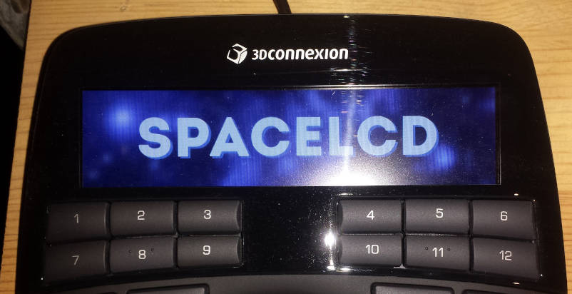

# SpaceLCD


**SpaceLCD** displays SVG images on the SpaceMouse Enterprise 3D mouse. It can also control the LCD brightness and perform partial (alpha-blend) screen updates and animations.

## Getting Started


### Prerequisites

SpaceLCD requires libusb to control the 3D mouse, librsvg to parse the SVG and also zlib to compress the images.

Optional requirements are [swig](http://www.swig.org) for generating the Python bindings, and [Unity](http://www.throwtheswitch.org/unity) for running the unit tests.

[Bear](https://github.com/rizsotto/Bear) and [ctags](https://ctags.io/) are optionally used during development.

### Installing

Clone the repository and build the library and Python module:

```
git clone --recursive https://github.com/TheHoodedFoot/SpaceLCD.git
cd SpaceLCD
./configure
make
```

You should be able to test that SpaceLCD is working by issuing the following commands, which turn the LCD on, sends a test graphic, resets the device, and turns the LCD off respectively:

```
make -C src lcdon
make -C src logo
make -C src reset
make -C src lcdoff
```

### Permissions

Spacelcd needs write permissions for the SpaceMouse. There are some example udev rules included.

## Code Example

~~~{.py}
import spacelcd

with open("logo.svg", "r") as svgfile:
    svg = svgfile.read()

# Full-screen replace (existing content overwritten)
spacelcd.svgtolcd(svg, spacelcd.scroll.none)

# Alpha-blend overlay (existing content preserved where SVG is transparent)
spacelcd.svgtolcd_partial(svg, 0)
~~~


## Background

The SpaceMouse Enterprise has a 640×150 pixel display with 16-bit BGR565 colour support (bits 0–4: Red, bits 5–10: Green, bits 11–15: Blue). Images are sent to the display with a 512-byte header, followed by the bitmap, which is compressed using raw deflate (zlib).

SpaceLCD is only used to control the display; [spacenavd](http://spacenav.sourceforge.net) and [libspnav](http://spacenav.sourceforge.net) are required in order to read the motion data from the mouse.

## Partial Updates and Animation

The display supports two update modes controlled by the first byte of the 512-byte header:

- **`0x11` (FULL / instant)** — replaces the entire framebuffer.
- **`0x18` (PARTIAL / alpha blend)** — blends with the existing framebuffer. Zero pixels are transparent (left unchanged on screen), non-zero pixels are opaque (written).

### Library API

```c
/* Full-screen replace */
svgtolcd(svg_data, EFFECT_CUT);          /* 0x11 — replaces entire screen */

/* Alpha-blend partial update (zeros = transparent) */
svgtolcd_partial(svg_data, 0);           /* 0x18 — blends with existing screen */

/* Send a raw 640×150 BGR565 bitmap */
lcd_send_bitmap(bitmap, EFFECT_CUT);     /* full replace */
lcd_send_bitmap(bitmap, EFFECT_PARTIAL); /* alpha blend */

/* Large bitmaps: split into 4 horizontal tile updates */
lcd_send_bitmap_tiled(bitmap, EFFECT_PARTIAL, 4);

/* Animation: send frames at a target frame rate */
lcd_animate(frame_bitmaps, num_frames, 30, EFFECT_PARTIAL);
```

### Python example

```python
import spacelcd

with open("logo.svg", "r") as f:
    svg = f.read()

# Full-screen replace
spacelcd.svgtolcd(svg, spacelcd.scroll.none)

# Alpha-blend overlay (existing screen content preserved)
spacelcd.svgtolcd_partial(svg, 0)
```

### CLI

```
# Send a .bulk capture file as a partial (alpha-blend) update
splcdcmd -p capture.bulk
```

## Limitations

SpaceLCD has only been tested using one SpaceMouse Enterprise, with USB ID 256f:c633, bought as part of the SpaceMouse Enterprise Kit 3DX-700058.

The header uses a 16-bit value to hold the length of the compressed bitmap, limiting its size to 65535 bytes. For images that compress above this limit, `lcd_send_bitmap_tiled()` splits the bitmap into horizontal strips sent as sequential partial updates.

Operating system support is currently GNU/Linux only.

## Using the SpaceMouse Enterprise with as a 3d mouse with spacenavd

The current version of [spacenavd](http://spacenav.sourceforge.net), 0.6, does not include the USB vendor and product ids for the SpaceMouse Enterprise, so although SpaceLCD can control the display, the device itself will not work as a 3d mouse. A patch for spacenavd is included [here](/res/etc/add_spaceexplorer_enterprise.patch) which adds the SpaceMouse Enterprise as a recognised device.

In addition, spacenavd/libspnav do not currently report all of the buttons correctly. An event input test program (evdevtest.py) is included which shows that all buttons can be uniquely identified, but the necessary changes to spacenavd or libspnav have not yet been examined.

## Known Issues

### Device Lockup

The SpaceMouse is vulnerable to corrupted data, which can cause the display to become unresponsive, requiring a hard power cycle. This can be triggered by rapid successive USB open/reset/close cycles during animation. To avoid this, use `lcd_animate()` for rapid frame sequences rather than calling `svgtolcd()` in a tight loop.

### Endianness

The pixel format is BGR565 stored as little-endian 16-bit words. This has been verified on x86; behaviour on big-endian architectures has not been tested.

## Inkscape Plugin

The code also includes a plugin for Inkscape version 1.0, which requires [scour](http://github.com/scour-project/scour) to be installed. The plugin uploads the current Inkscape drawing to the SpaceMouse, which is useful when prototyping GUI elements.

## Built With

* [libusb](https://libusb.info) - Portable, userspace USB access
* [zlib](https://www.zlib.net) - Compression algorithm used by the SpaceMouse
* [librsvg](https://github.com/GNOME/librsvg) - Used to generate a bitmap from SVG data

## Authors

* **Andrew Black** - *Initial work* - [github](https://github.com/TheHoodedFoot)
* **Qwen 3.6** - *Partial update work* - Fair play, it saved me a lot of work.

## License

This project is licensed under the zlib License

## Acknowledgments

* spacenavd / libspnav
* zlib
